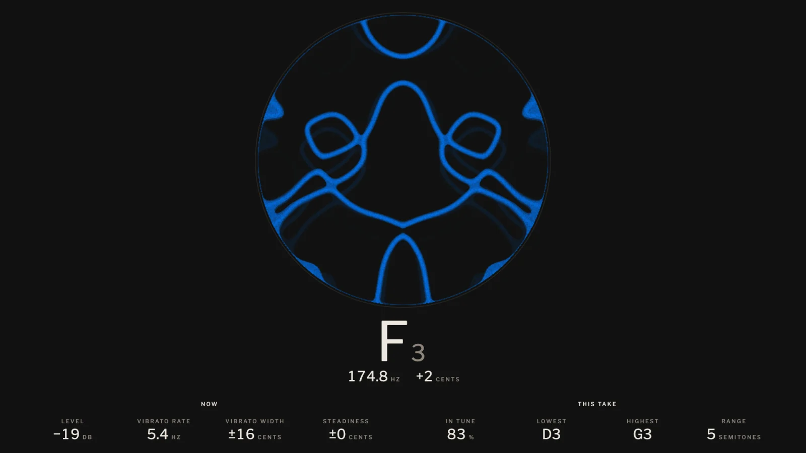
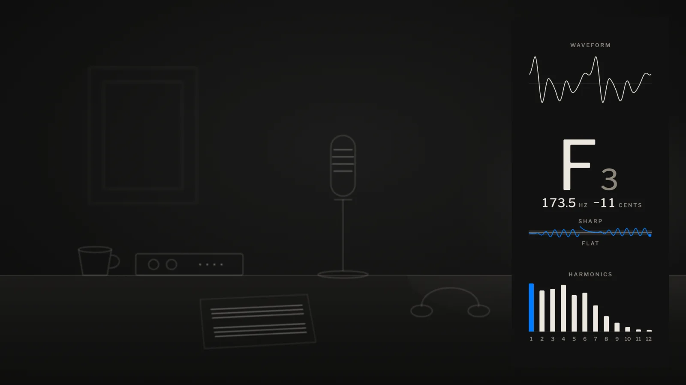
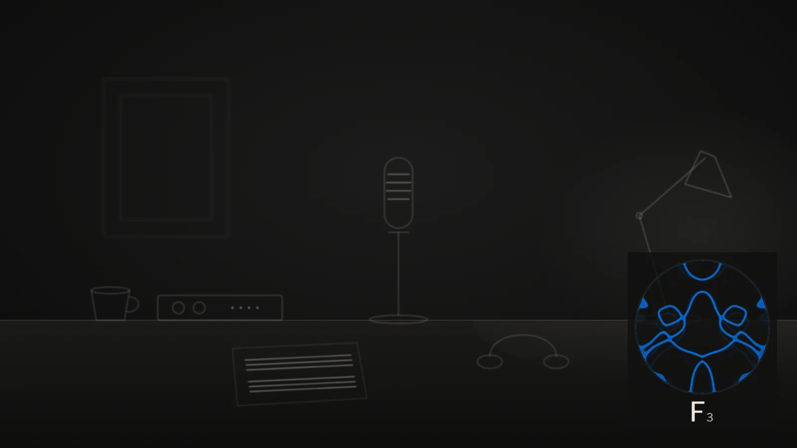
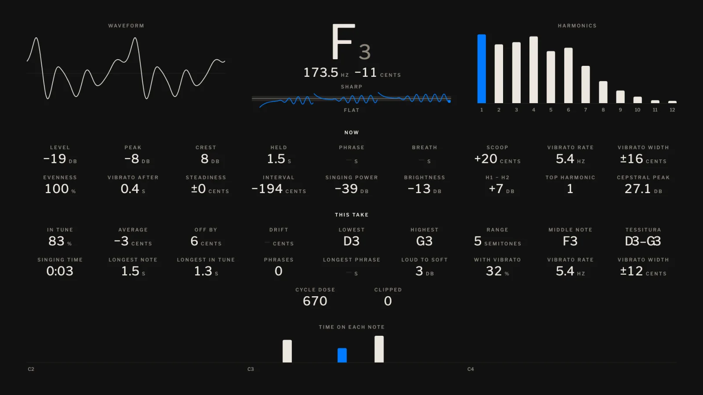
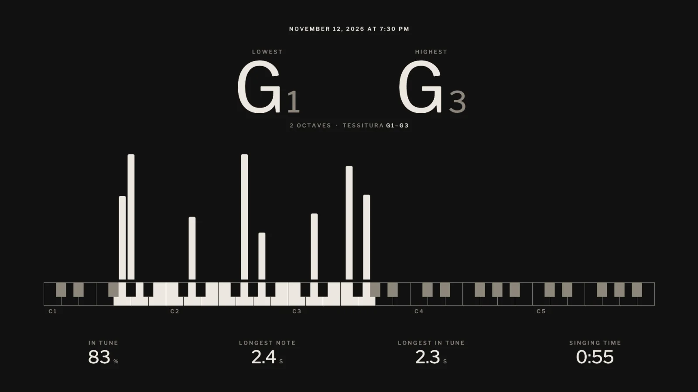

# Tonoscope

A live note and harmonics display for singers. For Mac. Free and open source.

Tonoscope™ by [Haedo Labs™](https://haedolabs.com). In the works: [tonoscope.io](https://tonoscope.io).

It listens to a singer and draws what it hears, as they sing: the note, its pitch in hertz and cents, the waveform, and the harmonics. It goes into OBS through its Browser source, or stands in a window of its own. Everything it hears stays on the Mac.

## Two kinds of view

**Overlays** stand beside the face or in a corner.

The sand figure is modeled on the sand drum of the 1960s: each harmonic of the note shakes the drum in its own way, and the sand gathers where the drum is still. Low notes make plain figures, and high notes intricate ones. It stands in a corner, or fills the screen.

**Dashboards** fill the screen, for practice: the note, and the singer's numbers, now and for the whole take.

After a take, its summary: the lowest and highest notes, the tessitura, and the time in tune.

The pictures are drawn from synthetic sound.
