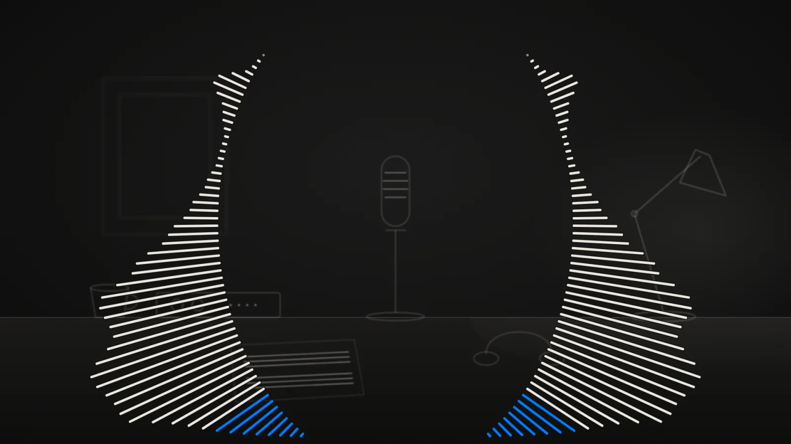
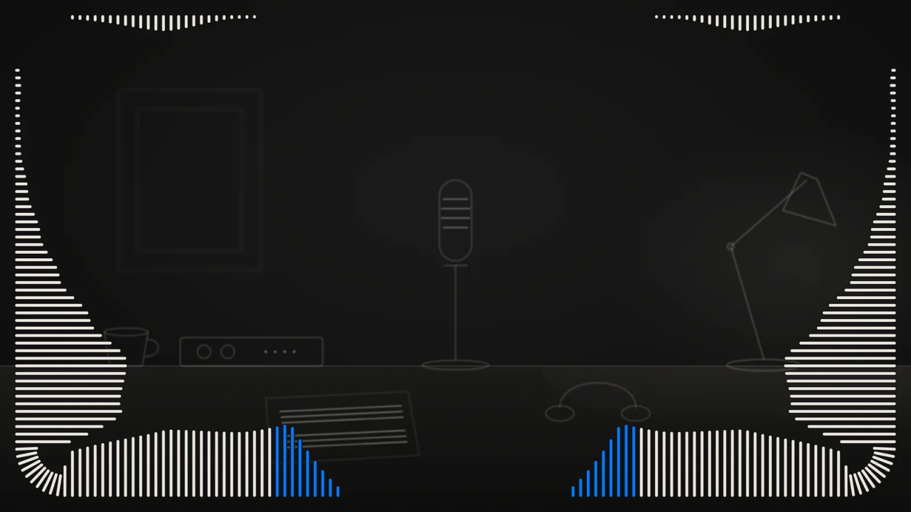
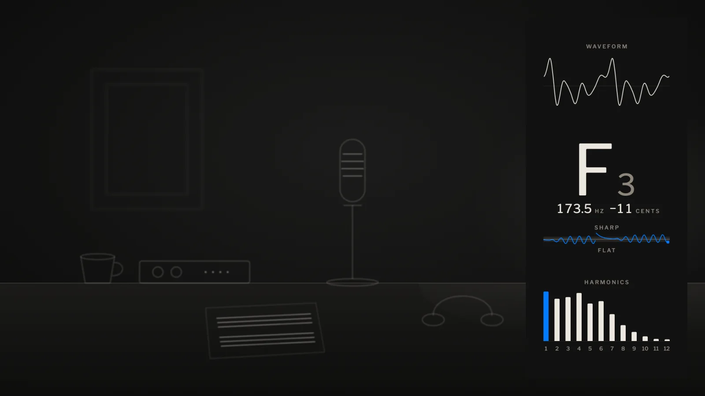
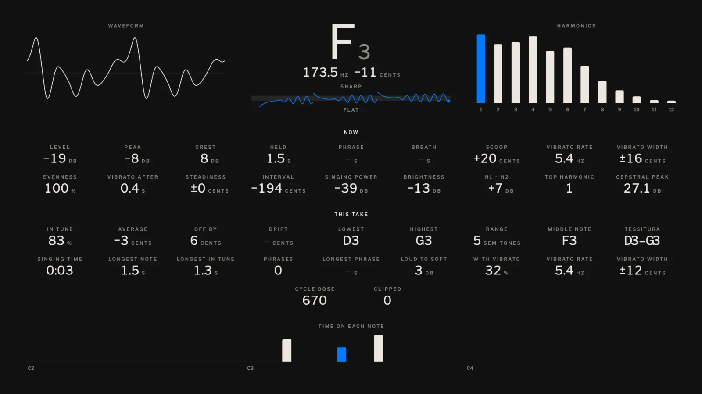
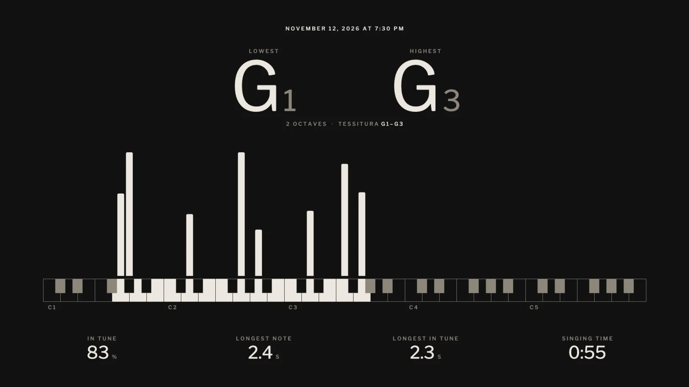

# Tonoscope

A live note and harmonics display for singers. For Mac. Free and open source.

Tonoscope™ by [Haedo Labs™](https://haedolabs.com). In the works: [tonoscope.io](https://tonoscope.io).

It listens to a singer and draws what it hears, as they sing: the note, its pitch in hertz and cents, the waveform, and the harmonics. It goes into OBS through its Browser source, or stands in a window of its own. Everything it hears stays on the Mac.

## Three kinds of view

**Borders** frame the singer and never cross the face.

**Overlays** stand beside the face or in a corner.

**Dashboards** fill the screen, for practice: the note, and the singer's numbers, now and for the whole take.

After a take, its summary: the lowest and highest notes, the tessitura, and the time in tune.

The pictures are drawn from a made-up voice.
